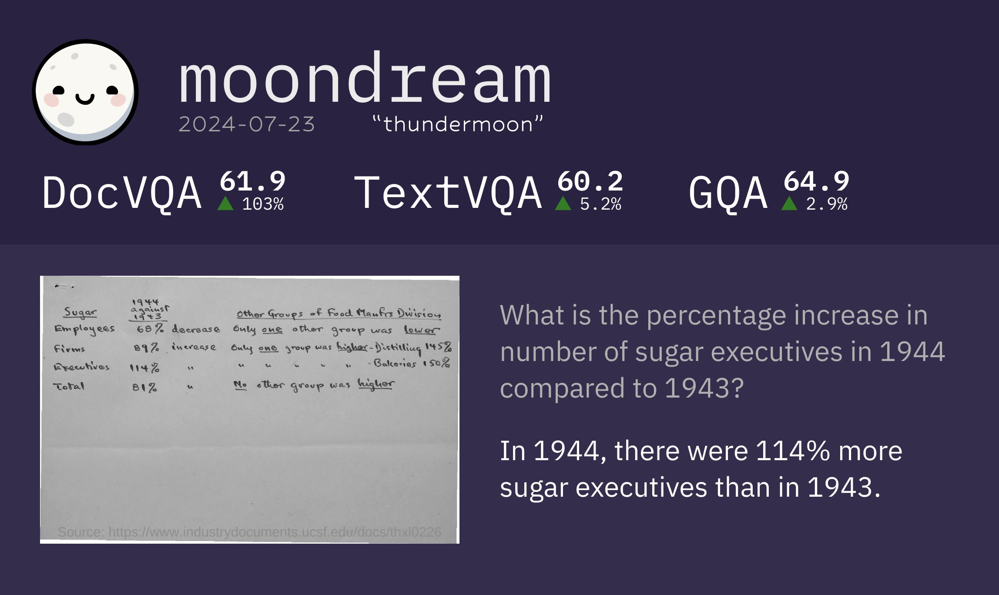

# vikhyatk/moondream2 Cog model

This is an implementation of the model [vikhyatk/moondream2](https://huggingface.co/vikhyatk/moondream2) as a Cog model. [Cog packages machine learning models as standard containers.](https://github.com/replicate/cog)

# Run a prediction:

    cog predict -i image=@demo.png

## License

The code in this repository is licensed under the [Apache License 2.0](LICENSE).

The model weights are not covered by this license. [vikhyatk/moondream2](https://huggingface.co/vikhyatk/moondream2) is released under the [Apache 2.0](https://www.apache.org/licenses/LICENSE-2.0) license.
